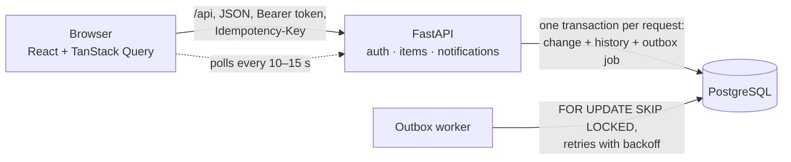

# Newtonite Ops

An internal tool for coordinating operational work: incidents, customer issues, payments, compliance requests and tasks.
Teams create **work items**, claim or assign them, move them through a workflow (with lead approval for risky types),
discuss them, and see at a glance what needs attention. Every change is recorded, and the system behaves correctly when
several people act on the same item at the same time.

- **Backend:** Python 3.13, FastAPI, SQLAlchemy 2, PostgreSQL, Alembic, a separate outbox worker process
- **Frontend:** React + TypeScript (Vite), TanStack Query, React Router
- **Tests:** pytest against a real Postgres database (51 tests)

Design reasoning is in [ENGINEERING_DECISIONS.md](ENGINEERING_DECISIONS.md).

---

## Architecture



1. The browser calls the API. Every write carries an `Idempotency-Key`, and every change names the item `version` it was based on.
2. The API checks the caller's team role, applies the workflow rules, and writes the item change, its history event, any
   notification job and the idempotency record **in one transaction**.
3. The worker picks up jobs (`FOR UPDATE SKIP LOCKED`), creates notifications, and retries failures with backoff.
4. The browser polls for fresh data and notifications. Conflicts are detected by the server (versions), not by timing.

### Code layout (feature modules)

```
backend/app/
  core/           shared plumbing: config, db session, error format, idempotency (no business rules)
  auth/           users, teams, roles · login and JWT · authorize(): the only place permissions are decided
  items/          work items · workflow.py (the rules) · service_query.py (reads) · service_command.py (writes)
  notifications/  outbox jobs · worker · notifications API
backend/tests/    pytest suite, one file per risk area
frontend/src/     api.ts (typed client) · pages/ (Dashboard, ItemDetail, NewItem, Login)
```
Dependencies point one way: `core ← auth ← items → notifications`.

---

## Running it

### Option A: Docker (one command)

Prerequisite: Docker Desktop running.

```bash
cp .env.example .env        # optional: defaults work for local use
docker compose up --build
```

Open **http://localhost:8080**. The API container applies migrations and seeds demo data on first start
(about 10 seconds). API docs: http://localhost:8000/docs. Postgres is exposed on port **5433**, so it does not clash with
a local install.

Stop with `Ctrl+C`; `docker compose down -v` also deletes the data.

### Option B: Local development

Prerequisites: Python 3.13 with [uv](https://docs.astral.sh/uv/), Node 20+, and PostgreSQL 15+ running on `localhost:5432`.

```bash
# 1. Databases (dev + test)
createdb -U postgres newtonite
createdb -U postgres newtonite_test

# 2. Backend
cd backend
uv sync
uv run alembic upgrade head
uv run python -m scripts.seed              # 4 teams, 11 users, 5,000 items with history
uv run uvicorn app.main:app --reload       # terminal 1: API on :8000

uv run python -m app.notifications.worker  # terminal 2: background worker

# 3. Frontend
cd frontend
npm install
npm run dev                                # terminal 3: http://localhost:5173 (proxies /api to :8000)
```

If your Postgres needs a password, set `DATABASE_URL` / `TEST_DATABASE_URL` in `.env` (see `.env.example`).
`uv run python -m scripts.seed --reset` wipes and reseeds.

---

## Demo accounts

All passwords: **`demo1234`**. Roles are per team; some people are in several teams with different roles.

| Email | Who | Roles |
|---|---|---|
| `priya@newtonite.example` | Priya Raman | **lead** of Payments Ops, **member** of Compliance & Risk |
| `marco@newtonite.example` | Marco Silva | member of Payments Ops |
| `sam@newtonite.example` | Sam Okafor | member of Payments Ops and Customer Support |
| `dev@newtonite.example` | Dev Kapoor | member of Platform Engineering, **viewer** of Payments Ops |
| `victor@newtonite.example` | Victor Auditor | viewer of Payments Ops and Compliance & Risk |
| `lena@newtonite.example` | Lena Novak | lead of Platform Engineering |
| `chloe@newtonite.example` | Chloe Martin | lead of Customer Support |
| `rita@newtonite.example` | Rita Gomez | lead of Compliance & Risk |
| `admin@newtonite.example` | Asha Admin | global admin (sees every team) |

**Role rules:** viewers read and comment; members also create, claim, edit and move **their own** items;
leads also approve or reject, assign, close, and act on any item in their team.

---

## Running the tests

```bash
cd backend
uv run pytest
```

The tests need the `newtonite_test` database (Option B, step 1; or set `TEST_DATABASE_URL`). They refuse to run
against a database whose name doesn't end in `_test`, migrate it automatically, and empty it before every test.

| File | What it protects |
|---|---|
| `test_concurrency.py` | Parallel claims (real threads): exactly one wins · stale edits rejected, data untouched · no lost updates |
| `test_idempotency.py` | Retries and concurrent duplicates create one item · key reuse with a different body rejected · keys per user |
| `test_workflow.py` | Impossible moves · payment/compliance can't skip approval · lead-only approval · rejection needs a note |
| `test_authorization.py` | Other teams' items are 404 everywhere and absent from lists/search · viewer/member/lead limits |
| `test_history_and_worker.py` | One history event per change · no history for rejected changes · retries, backoff, no duplicate notifications |
| `test_listing.py` | Pagination sees every item exactly once even while items are added · search · views agree with counts |

---

## A 5-minute demo

1. **Dashboard** (log in as Priya): the four "needs attention" tiles, then search ("refund"), filter and sort by priority.
2. **Claim race:** open the same unassigned item as Marco and as Sam in two browsers and click **Claim** in both.
   One wins; the other sees "Someone else claimed this item first" and the winner's name.
3. **Stale edit:** Priya opens *Edit details*; meanwhile Rita changes the priority. Priya saves and gets a conflict panel
   with her draft kept, and can **apply her changes on top of Rita's** (only the fields she changed are sent).
4. **Approval:** as Marco, move a *payment* item to in progress. *Resolve* is not offered; *Request approval* is.
   Priya gets a notification (bell), then approves or rejects it (a rejection asks for a reason).
5. **Authorization:** as Dev (viewer of Payments), open a Payments item: comment works, there are no action buttons,
   and calling the API directly returns 403. As Lena (another team), the same item's URL returns 404.
6. **History:** every step above appears in the item's activity timeline.

---

## API overview

Interactive docs at `/docs`. All errors use one shape: `{"error": {"code", "message", "details"}}`.

| Method & path | Purpose |
|---|---|
| `POST /auth/login` · `GET /me` · `GET /teams/{id}/members` | Login, current user with team roles, team members |
| `GET /items?view=&team_id=&status=&priority=&type=&assignee=&q=&sort=&cursor=&limit=` | Filtered, searchable, keyset-paginated list |
| `POST /items` | Create |
| `GET /items/{id}` · `PATCH /items/{id}` | Detail (including `allowed` actions for the caller) · partial edit with `expected_version` |
| `POST /items/{id}/claim` · `/assign` · `/transition` · `/comments` | Claim · assign/release · workflow move · comment |
| `GET /items/{id}/activity` | History, newest first |
| `GET /dashboard/counts` | Counts for the four views |
| `GET /notifications` · `POST /notifications/{id}/read` · `POST /notifications/read-all` | Notification feed |

Writes accept an `Idempotency-Key` header. Conflicts return **409** with the current item in `details.current`.

---

## Known limitations

- **Sessions can't be revoked early.** JWTs are valid until they expire (8 h); "log out" only forgets the token in the
  browser, and the token is kept in `localStorage` (readable by any script on the page). Next: short-lived access
  tokens plus a refresh token in an httpOnly cookie.
- **Polling, not push.** Screens refresh every 10–15 s. Correctness doesn't depend on it (versions catch stale writes),
  but you can see slightly old data for a few seconds.
- **No admin screens.** Users, teams and roles come from the seed script.
- **Leaving a team doesn't reassign work.** The "assignee must be in the team" rule is checked when assigning; items
  already assigned to someone who later leaves keep that assignee.
- **Search ranks by recency, not relevance,** and uses English stemming only.
- **Failed jobs are only visible in the database** (`jobs.status = 'failed'`, with `last_error`). There is no retry UI.
- **The worker processes a job inside one transaction.** That's simple and safe for today's quick, database-only
  handlers; a slow external call (e.g. sending email) would need a lease-based design instead.
- **The frontend has no automated tests.** Its key flows (claim race, conflict merge, approval) were verified by hand.
- History, jobs and notifications are kept forever. Idempotency keys are deleted after 24 h by the worker.

## Next week I would…

1. Move the token to an httpOnly cookie with refresh tokens, and add an admin screen for teams and roles.
2. Push updates over Server-Sent Events from the worker, so open screens update instantly.
3. Add SLA targets per priority, with an escalation job when an item is about to breach.
4. Add a "failed jobs" admin view with a retry button, and metrics (queue depth, job latency).
5. Add Playwright tests for the three UI flows above.
6. At 10× scale: partition `activity_events` by month, add a read replica for lists and counts, and move search to a
   dedicated engine if relevance ranking becomes important.
